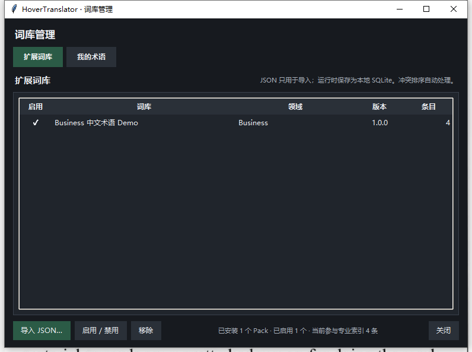
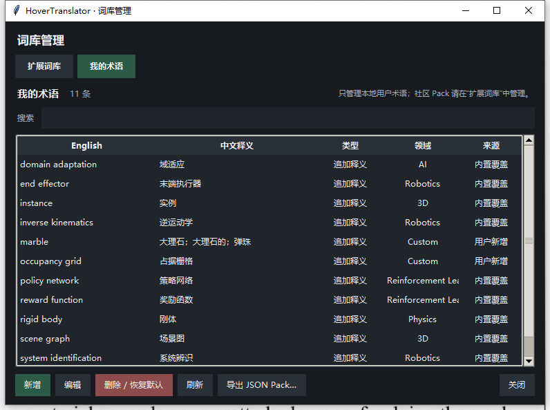

# HoverTranslator · Windows 离线悬浮翻译工具

**Free-to-use Windows utility · Local OCR · English–Chinese dictionary · Offline AI translation**

HoverTranslator 是一款 Windows 悬浮翻译工具，集成 Windows OCR（光学字符识别）、本地词典和离线英译中后端。目标是让用户在技术文档、网页或其他桌面界面阅读英文时，以鼠标悬停完成查词和整句翻译。

> **发布状态：尚未公开提供完整版软件下载。** 当前私有开发仓库的 Portable 发行候选包已通过静态完整性校验；部分第三方再分发权及此前 Windows Defender `Trojan:Win32/Bearfoos.B!ml` 检测仍待澄清。不要关闭安全防护以运行被拦截的文件。[查看详细状态](docs/RELEASE_STATUS.md)

## 功能特点

- **Ctrl + Hover**：单词与短语查询、词性及音标展示。
- **Alt + Hover**：英文句子 OCR 识别与中文翻译。
- **离线翻译**：针对英语到中文的本地推理与词典查询。
- **术语管理**：支持自定义专业术语及扩展词库包。
- **便携运行**：计划以 Windows x64 Portable 形式交付完整软件。

## 实际运行截图

### 单词查询

### 整句翻译

### 术语与扩展词库

| 扩展词库 | 自定义术语 |
|:---:|:---:|
|  |  |

<!-- BEGIN D7-6D-6E USER DOCUMENTS -->
## 下载、使用与反馈

**当前尚无获准公开下载的软件包。** `v0.7.21-rc.1` 已完成本地功能及打包测试，但发行候选仍处于 HOLD，不代表可以对外分发。

- [Windows Portable 使用说明](docs/QUICK_START_zh-CN.md)
- [问题反馈与隐私提示](docs/FEEDBACK_zh-CN.md)
- [发布状态](docs/RELEASE_STATUS.md)
- [提交问题或功能建议](https://github.com/yuxingh391-hub/HoverTranslator2.0/issues/new/choose)

<!-- END D7-6D-6E USER DOCUMENTS -->

## 授权模式

HoverTranslator 计划允许免费使用获准发行的官方软件，**但不公开完整原创源代码，也不授予他人对专有部分的商业再分发或二次开发权利**。具体以随正式发行包提供的最终用户许可为准。上游 MIT、Apache-2.0、CC BY 4.0 等第三方材料的权利仍按原许可证独立处理。

- [授权与第三方权利说明](docs/LICENSING_AND_THIRD_PARTIES.md)
- [拟定最终用户许可草稿](docs/END_USER_LICENSE_DRAFT.md)
- [发布与安全状态](docs/RELEASE_STATUS.md)

本仓库仅作为公开项目展示及未来发行入口；**不包含完整 Python 开发源码**。
